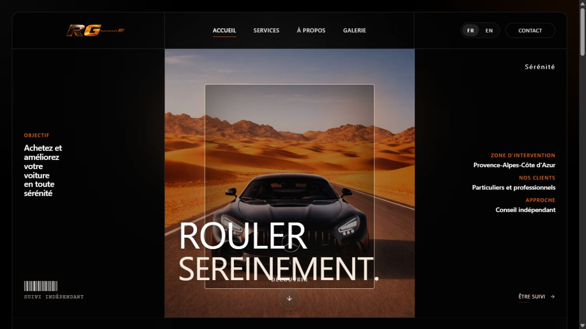
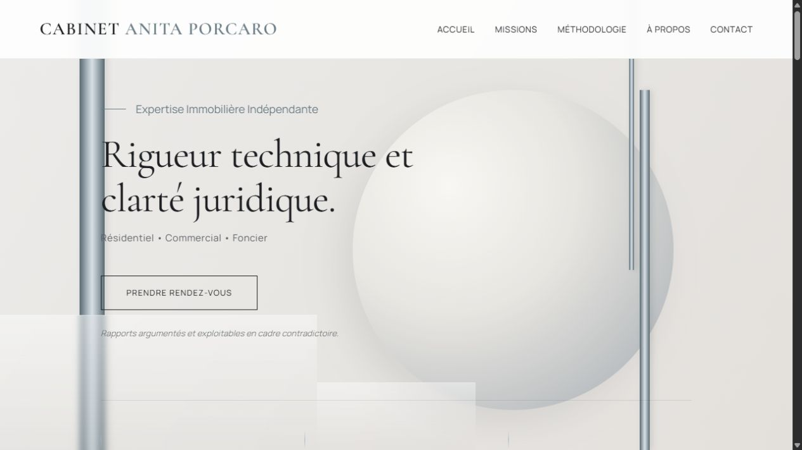
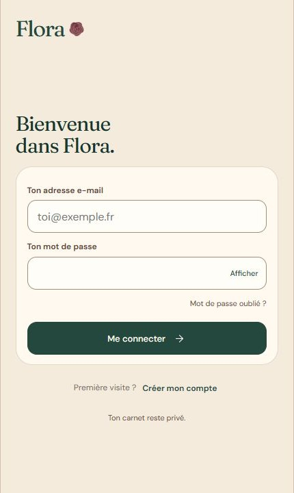

# Ethan Porcaro

## Frovely.app

Une application web pour centraliser ses abonnements et suivre ses dépenses récurrentes.

[Découvrir Frovely](https://frovely.app)

## RG Auto Conseil

Site vitrine bilingue pour une activité de conseil automobile indépendant. Il présente les prestations, les réalisations et les moyens de prendre contact.

[Visiter RG Auto Conseil](https://rgautoconseil.fr)

## Cabinet Porcaro

Site vitrine d’un cabinet d’expertise immobilière. Il présente les missions, la méthodologie et la prise de rendez-vous.

[Visiter le site du cabinet](https://www.cabinet-porcaro.com)

## Flora

Un carnet quotidien pensé pour le mobile, avec un calendrier pour retrouver ses bilans et suivre sa régularité.

